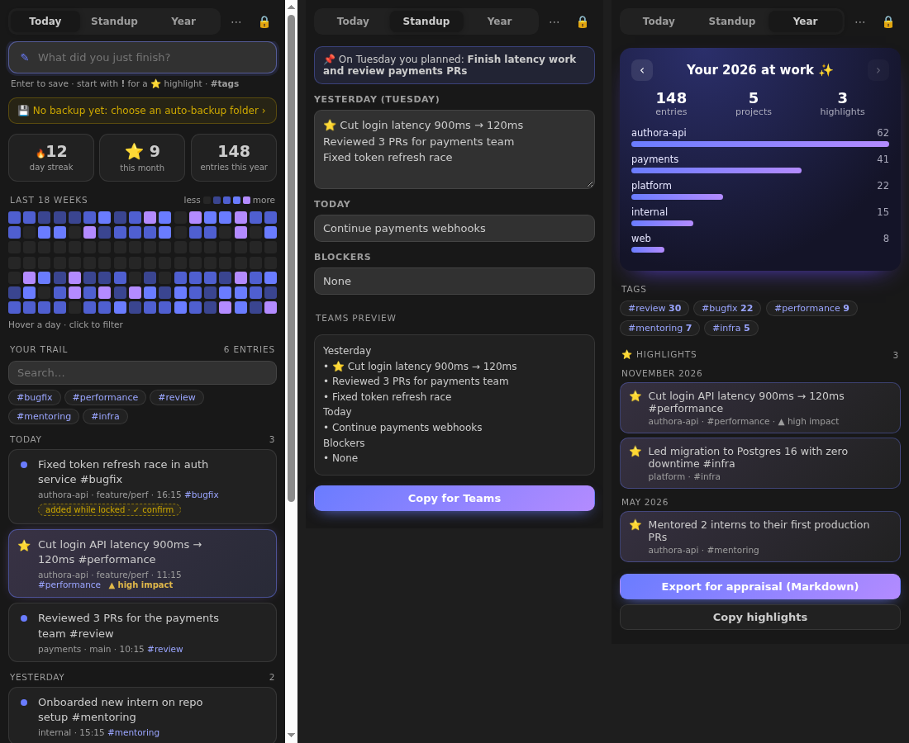
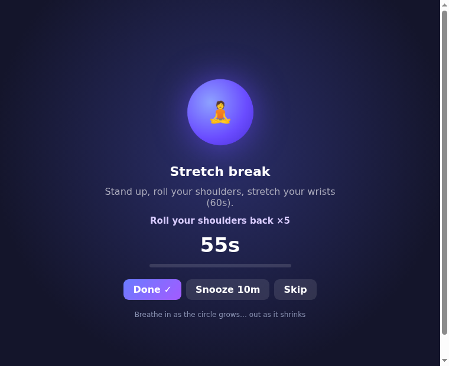

# Wintrail: your private trail of work wins

Log what you finish in 3 seconds, keep it **encrypted**, and at appraisal time see your whole year, with the
⭐ exceptional work at the top. Wintrail also drafts your **daily standup** for Teams and reminds you to take
**breaks** while you code.



## Features
- **3-second logging:** `Ctrl+Alt+L` (`Cmd+Alt+L` on macOS) from anywhere, or the box at the top of the sidebar.
  - Start with **`!`** to mark a ⭐ highlight; add `#tags`.
  - The project and git branch are filled in for you.
  - **Logging never needs the password**, even while Wintrail is locked.
- **Encrypted, private log.** Reading it needs your password, nothing leaves your machine, and there's no telemetry.
- **Dashboard:**
  - 🔥 working-day streak, ⭐ highlights this month, entries this year;
  - an 18-week activity heatmap (click a day to filter);
  - a searchable timeline with tag filters, inline edit, star, impact and delete.
- **Year in Review:** your appraisal year (calendar year, or set `wintrail.yearStartMonth`, e.g. 4 for April–March) with:
  - project bars, tag counts and your ⭐ highlights grouped by month;
  - **Export for appraisal (Markdown)** and **Copy highlights**.
- **Standup for Teams:**
  - **Yesterday** comes from your previous working day's log (Monday covers Friday), or that day's git commits if you logged nothing.
  - **Today** comes from your branch name.
  - **Blockers** defaults to None.
  - Yesterday's plan is shown above the draft. Edit it, then **Copy for Teams**.
- **Break Buddy:** 👀 eyes (20 min), 🧘 stretch (50 min) and 💧 water (75 min) reminders.
  - They count **active coding time only**, never stack, and never burst after sleep.
  - Each one can be a notification or a full animated break screen.
  - Focus mode, optional working hours, and **every timing is adjustable** in the ⚙ card or in settings.



## Privacy & security model
- **Keys:**
  - Your password goes through **Argon2id** (64 MiB, 3 passes) and unlocks a private **X25519** key and a MAC key.
  - New entries are sealed to the public key (ECDH, HKDF and AES-256-GCM). That's why you can add while locked but not read.
- **What's on disk:** everything about an entry is encrypted: text, date, project, branch, tags, star, and which entry an edit targets.
  Entries are padded to 256-byte buckets. Still visible: the number of records and when the files were last written.
- **Edits and deletes:**
  - These need an unlocked session (HMAC), so someone at your desk can't silently delete or change entries.
  - Entries added while locked show **"added while locked · ✓ confirm"** until you confirm them. That's how a fake entry would be noticed.
- **Tampering is detected:**
  - The public key is bound to your private key, so a swapped key file is refused instead of used.
  - Removing or replaying authentic lines triggers a "log was changed" warning.
  - Malformed records are ignored.
- **Changing your password** creates brand-new keys, re-encrypts everything, and leaves no copy of the old keys.
  It is crash-safe: an interruption rolls forward or back on the next unlock. Wintrail then offers to delete older backups,
  which still open with the old password.
- **Other safeguards:**
  - Locks on start and after 15 idle minutes (`wintrail.autoLockMinutes`).
  - Wrong passwords are throttled.
  - Optional "remember on this machine" uses the OS keychain. **Lock** deletes it and locks every open VS Code window.
  - Several VS Code windows are safe at the same time.
- **Backups:** auto-backup to a folder you choose (e.g. inside Dropbox, Drive or OneDrive). Backup files are the encrypted log and open with your password.
  **Import backup** merges and never replaces; your current log is backed up first.
- The **only plaintext output** is the appraisal export, and it asks first.
- **Git:** the standup reads git only in trusted workspaces, and only when your log is empty for that day. It always disables
  repository settings that could run programs.
- **Known limits:**
  - Someone who can already write your files and VS Code's own storage can still receive *future* entries added while
    Wintrail is locked. Your history stays protected, and unlocking reveals the tampering.
  - Rolling back the log together with its integrity record to an older matching copy isn't detectable.

There is **no password recovery**. Turn on auto-backup.

## Settings
All settings are user-level only, so a repository's `.vscode/settings.json` can't change them.

| Setting | Default |
|---|---|
| `wintrail.autoLockMinutes` | 15 |
| `wintrail.rememberOnThisMachine` | false |
| `wintrail.autoBackupFolder` / `wintrail.backupKeep` | "" / 10 |
| `wintrail.yearStartMonth` | 1 |
| `wintrail.breaks.{eyes,stretch,water}.{interval,enabled,style}` | 20/50/75 min, on, notification |
| `wintrail.breaks.{eyeSeconds,stretchSeconds,snoozeMinutes,idleMinutes,resetMinutes}` | 20, 60, 10, 5, 5 |
| `wintrail.breaks.focusPresets` / `workHours.start` / `workHours.end` | [60, 120] / "" / "" |

## Develop
```bash
npm install
npm test               # unit tests (+ timezone runs)
npm run typecheck      # tsc + svelte-check
npm run build
npm run package        # → wintrail-<version>.vsix
test/integration/run.sh /tmp/wintrail-it   # real VS Code smoke test
```

## Releasing (maintainers)
Add a `## x.y.z` section to `CHANGELOG.md`, then run `npm version patch` and `git push --follow-tags`.
The Release workflow publishes to the VS Code Marketplace (trusted publishing), to Open VSX (`OVSX_PAT` secret) and to GitHub Releases.

## License
MIT
